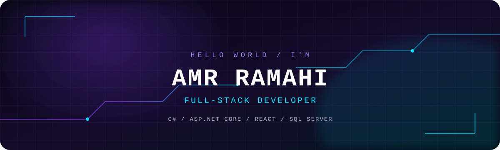

<div align="center">



<a href="https://readme-typing-svg.demolab.com">
  
</a>

<p>
  <a href="https://github.com/amrra05"></a>
  <a href="https://github.com/amrra05/DigitalWalletSystem"></a>
  <a href="https://digitalwallet-amr-frontend.pages.dev/"></a>
</p>

</div>

---

<h2 align="center">「 ABOUT ME 」</h2>

```yaml
name: Amr Ramahi
username: amrra05
role: Full-Stack Developer
currently_building:
  - ASP.NET Core Web APIs
  - React applications
  - Database-driven systems
interests:
  - Backend architecture
  - Clean user interfaces
  - UI/UX design
motto: "Build. Learn. Improve. Repeat."
```

- I enjoy building complete applications, from backend services and database design to responsive frontend experiences.
- My current toolkit includes **C#, ASP.NET Core, React, and SQL Server**.
- I care about maintainable code, useful features, and thoughtful user experiences.

---

<h2 align="center">「 FEATURED PROJECTS 」</h2>

<table>
<tr>
<td width="50%" valign="top">

<h3>01 · DigitalWalletSystem</h3>

A full-stack digital wallet with user and admin experiences.

- Wallet deposits, withdrawals, and transfers
- Transaction history and status tracking
- Admin dashboard and user management
- JWT authentication and protected routes
- Clean Architecture and EF Core

**Built with**


<p>
<a href="https://github.com/amrra05/DigitalWalletSystem">↗ Source code</a> ·
<a href="https://digitalwallet-amr-frontend.pages.dev/">↗ Live demo</a>
</p>
</td>
<td width="50%" valign="top">

<h3>02 · UI/UX Design</h3>

A Figma-based interface design project focused on layout, usability, and visual communication.

- Interface design in Figma
- UI/UX Assignment 2 — Part 2

**Designed with**


<p>
<a href="https://www.figma.com/design/pRVMZ0K5Dfd6OQRcDkL3DB/Assignment2_part2_amr-alramahi-169819?node-id=0-1">↗ View Figma design</a>
</p>
</td>
</tr>
</table>

---

<h2 align="center">「 TECH ARSENAL 」</h2>

<div align="center">

**BACKEND & DATABASE**


**FRONTEND**


**TOOLS & DESIGN**


</div>

---

<h2 align="center">「 GITHUB ANALYTICS 」</h2>

<div align="center">

<a href="https://github.com/amrra05">
  
</a>
<a href="https://github.com/amrra05">
  
</a>


</div>

---

<h2 align="center">「 CONTRIBUTION MATRIX 」</h2>

<div align="center">


</div>

---

<div align="center">


**`[ SYSTEM ONLINE ]`** &nbsp; **`[ ALWAYS BUILDING ]`**

<sub>Thanks for visiting · Let's build something meaningful.</sub>

</div>
